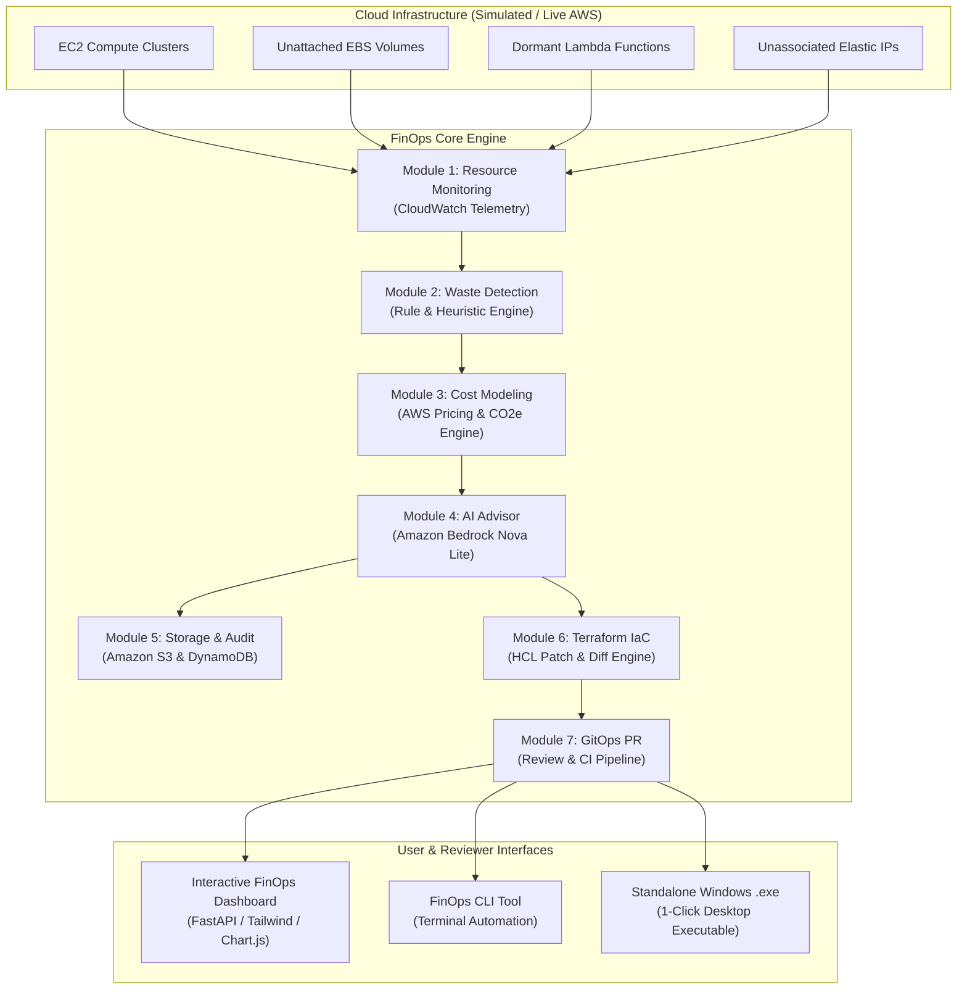

# FinOps Cloud Waste Hunter & Auto-Remediator

[](https://www.python.org/)
[](https://fastapi.tiangolo.com/)
[](https://aws.amazon.com/bedrock/)
[](https://www.terraform.io/)
[](https://github.com/)
[](LICENSE)

An automated Cloud Cost Optimization and DevOps platform that continuously monitors cloud infrastructure, discovers resource waste (unattached storage, idle serverless, and oversized compute), leverages **Amazon Bedrock Nova Lite** for actionable optimization insights, generates **Terraform IaC patches**, and enforces human review via **GitOps pull-request workflows**.

---

## 🎓 Academic Project Profile
- **Institution:** School of Computer Science Engineering and Information Systems, Vellore Institute of Technology (VIT)
- **Course Code:** ISWE309L Cloud Computing
- **Slot:** A1 + TA1
- **Review Phase:** Course Project Review-1
- **Project Team:**
  - **Vivek Pandey** &bull; Reg No: `24MIS0216` &bull; Email: `vivek.pandey2024@vitstudent.ac.in`
  - **S. Hemal** &bull; Reg No: `24MIS0050` &bull; Email: `hemal.s2024@vitstudent.ac.in`

---

## 🌟 Key Features & Problem Solved

Traditional cloud monitoring dashboards surface metrics but isolate detection from remediation, creating manual friction and persistent budget waste. **FinOps Cloud Waste Hunter** closes this loop:

$$\text{Resource Monitoring} \longrightarrow \text{Waste Detection} \longrightarrow \text{Cost Modeling} \longrightarrow \text{Bedrock AI Analysis} \longrightarrow \text{S3/DynamoDB Audit} \longrightarrow \text{Terraform Patching} \longrightarrow \text{GitOps Review}$$

1. **Module 1: Resource Monitoring**: Polls 30-day CloudWatch metrics (CPU, RAM, disk IOPS, network, attachments, invocation counts).
2. **Module 2: Multi-Vector Waste Detection**:
   - **Unattached Storage**: Orphaned EBS volumes (>7 days unattached) and unreferenced snapshots.
   - **Idle Serverless**: Inactive AWS Lambda functions with 0 invocations and dormant provisioned concurrency.
   - **Oversized Compute**: Underutilized EC2 instances (<10% avg CPU) mapped to right-sized families.
   - **Idle Networking**: Unassociated Elastic IPs incurring non-attachment fees and dormant NAT Gateways.
3. **Module 3: FinOps Cost & Carbon Modeling**: Real-time AWS SKU pricing engine calculating monthly spend, optimized spend, annualized ROI, and CO2e carbon reduction.
4. **Module 4: Amazon Bedrock Nova Lite AI Advisor**: Synthesizes human-readable rationales, risk levels (Low/Medium/High), step-by-step remediation procedures, and zero-downtime rollback strategies.
5. **Module 5: Report Storage & Audit Ledger**: Publishes full audit reports to **Amazon S3** (`s3://finops-waste-hunter-reports/`) and records indexed audit histories in **Amazon DynamoDB** (`FinOpsAuditTrail`).
6. **Module 6: Terraform Remediation**: Ingests infrastructure configurations and generates validated HCL patches (`main.tf`) with side-by-side unified diffs.
7. **Module 7: GitOps Review & Approval**: Branches into `gitops/remediation-run-*`, creates automated Pull Requests with CI/CD checks (`terraform validate`, `Cost Policy`, `Bedrock Guardrail`), and triggers controlled deployment upon reviewer sign-off.

---

## 🏗️ Architecture & Workflow



---

## 📋 Requirements Traceability Matrix

| Requirement | Description | Module Implementation | Verification Status |
| :--- | :--- | :--- | :---: |
| **FR1** | Collect and monitor resource-usage metrics | `core/module1_monitoring.py` | ✅ Verified |
| **FR2** | Identify unattached storage, idle serverless, oversized compute | `core/module2_waste_detection.py` | ✅ Verified |
| **FR3** | Classify detected waste by resource type | `core/models.py` (`ResourceType`) | ✅ Verified |
| **FR4** | Estimate potential monthly savings for detected waste | `core/module3_cost_estimation.py` | ✅ Verified |
| **FR5** | Provide detected waste to Amazon Bedrock Nova Lite | `core/module4_ai_advisor.py` | ✅ Verified |
| **FR6** | Generate optimization recommendations for identified waste | `core/module4_ai_advisor.py` | ✅ Verified |
| **FR7** | Generate reports containing waste, recs, and savings | `core/module5_storage.py` | ✅ Verified |
| **FR8** | Store reports and structured data in S3 and DynamoDB | `core/module5_storage.py` | ✅ Verified |
| **FR9** | Generate Terraform patches for recommended changes | `core/module6_terraform.py` | ✅ Verified |
| **FR10** | Submit generated changes as GitOps pull requests | `core/module7_gitops.py` | ✅ Verified |
| **FR11** | Keep infrastructure modifications reviewable before deployment | `core/module7_gitops.py` & Web UI | ✅ Verified |

---

## 🚀 Getting Started

### Prerequisites
- Python 3.10+ (Tested on Python 3.14 on Windows)
- Modern web browser (Chrome, Edge, Firefox)
- *Optional:* AWS credentials if connecting to live AWS account (`AWS_ACCESS_KEY_ID`, `AWS_SECRET_ACCESS_KEY`)

### 1. Instant 1-Click Launch (Windows)
Double-click:
```bat
start_app.bat
```
This automatically boots the backend server and opens `http://localhost:8080/` in your browser.

### 2. Manual Run via Python
```bash
# Clone the repository
git clone https://github.com/your-username/finops-cloud-waste-hunter.git
cd finops-cloud-waste-hunter

# Install dependencies
pip install -r requirements.txt

# Run web app & dashboard
python run_app.py
```

### 3. Command Line Interface (CLI)
For headless CI/CD execution or quick terminal demonstrations:
```bash
# Run full scan on Enterprise scenario
python cli.py --scenario enterprise

# Inspect a specific module (e.g., Module 4: Bedrock AI)
python cli.py --module 4

# Export audit report in Markdown format
python cli.py --format markdown > finops-audit-report.md
```

### 4. Compiling Standalone `.exe` Binary
To package the app into a standalone Windows executable:
```bat
build_exe.bat
```
The compiled executable will be generated at `dist/FinOps-Waste-Hunter/FinOps-Waste-Hunter.exe`.

---

## 📂 Project Directory Structure

```
finops-cloud-waste-hunter/
├── core/
│   ├── models.py                   # Pydantic data schemas across all 7 modules
│   ├── module1_monitoring.py       # Module 1: CloudWatch telemetry & inventory
│   ├── module2_waste_detection.py  # Module 2: Waste detection heuristic rules
│   ├── module3_cost_estimation.py  # Module 3: AWS pricing engine & CO2e calculation
│   ├── module4_ai_advisor.py       # Module 4: Amazon Bedrock Nova Lite advisor
│   ├── module5_storage.py          # Module 5: Amazon S3 & DynamoDB audit ledger
│   ├── module6_terraform.py        # Module 6: Terraform HCL patch & diff engine
│   ├── module7_gitops.py           # Module 7: GitOps pull request review engine
│   └── engine.py                   # End-to-end FinOps Orchestrator
├── app/
│   ├── server.py                   # FastAPI REST API backend
│   └── static/
│       ├── index.html              # Modern dark-mode FinOps dashboard
│       ├── styles.css              # Glassmorphism, badges, and diff syntax styles
│       └── app.js                  # Frontend controllers, Chart.js, and PR logic
├── sample_infrastructure/
│   ├── main.tf                     # Target Terraform infrastructure setup
│   └── variables.tf                # Deployment variables
├── data/
│   └── scenarios.py                # Enterprise, Startup, and Clean cloud datasets
├── storage/
│   ├── s3_bucket/reports/          # S3 audit files (JSON and Markdown)
│   └── dynamodb/                   # DynamoDB persistent audit table records
├── tests/
│   └── test_modules.py             # 100% passing unit tests for all 7 modules
├── cli.py                          # Terminal CLI runner
├── run_app.py                      # Desktop/Browser launcher
├── start_app.bat                   # 1-click Windows runner
├── finops.bat                      # Windows CLI shortcut
├── build_exe.bat                   # PyInstaller standalone executable builder
├── requirements.txt                # Python project dependencies
└── README.md                       # Comprehensive documentation
```

---

## 🧪 Automated Testing
Run the automated test suite covering all modules:
```bash
python -m unittest discover -s tests -p "test_*.py"
```

Output:
```text
Ran 8 tests in 0.065s
OK
```

---

## 🤖 Amazon Bedrock AI Advisor (Checkpoint 5)

The Bedrock AI Advisor provides real generative-AI optimization recommendations using Amazon Bedrock foundation models. It operates in **read-only, analysis-only mode** — it never modifies AWS resources, never runs `terraform apply`, and never fabricates evidence.

### Endpoint

```
POST /api/aws/advisor
```

**Request body** (all fields optional):

| Field | Type | Default | Description |
|-------|------|---------|-------------|
| `region` | string | `ap-southeast-2` | AWS region to analyze |
| `model_id` | string | env var | Override Bedrock model ID |
| `window_days` | int | `14` | CloudWatch metrics collection window |

**Example:**
```bash
curl -X POST http://localhost:8000/api/aws/advisor \
  -H "Content-Type: application/json" \
  -d '{"region": "ap-southeast-2", "window_days": 14}'
```

**Response fields:**

| Field | Description |
|-------|-------------|
| `status` | `CONNECTED`, `CREDENTIALS_MISSING`, `NO_PERMISSION`, `ACCOUNT_VERIFICATION_REQUIRED`, `MODEL_NOT_AVAILABLE`, `ERROR` |
| `account_id` | AWS account ID used (never fabricated) |
| `real_mode` | Always `true` for this endpoint |
| `recommendations` | List of structured Bedrock recommendations |
| `waste_findings_count` | How many waste findings were analyzed |
| `resources_discovered` | How many real AWS resources were discovered |
| `errors` | Per-finding error messages, if any |
| `assumptions` | Model-declared assumptions (from Bedrock output) |

### Evidence Pipeline (LIVE mode only)

The endpoint **always obtains evidence from real AWS** — the frontend cannot inject arbitrary findings:

```
STS authentication
→ EC2 / EBS / EIP / Lambda / S3 discovery
→ CloudWatch metrics (CPUUtilization, NetworkIn/Out, etc.)
→ Cost Explorer spend
→ Waste detection on real evidence
→ Amazon Bedrock recommendations
```

### Configuration

| Environment Variable | Purpose | Default |
|---------------------|---------|---------|
| `FINOPS_BEDROCK_MODEL` | Primary model ID override (highest priority) | — |
| `BEDROCK_MODEL_ID` | Secondary model ID override | — |
| `FINOPS_AWS_REGION` | Default AWS region | `ap-southeast-2` |
| `AWS_PROFILE` | AWS CLI named profile | — |

If neither env var is set, the service defaults to **`amazon.nova-lite-v1:0`**.

### Required AWS Permissions

The Bedrock advisor requires these IAM permissions (read-only):

```json
{
  "Effect": "Allow",
  "Action": [
    "sts:GetCallerIdentity",
    "bedrock:InvokeModel",
    "bedrock:ListFoundationModels"
  ],
  "Resource": "*"
}
```

Plus the permissions already required by Checkpoints 2–4 (EC2, CloudWatch, Cost Explorer).

### Safety Guarantees

- **No mutations**: Bedrock is called only with a read-only evidence payload.
- **No credentials in payload**: The evidence sent to Bedrock contains only resource IDs, types, regions, findings, and CloudWatch metrics. AWS credentials, access keys, secret keys, and session tokens are **never** included.
- **No fake fallback in LIVE mode**: If Bedrock cannot be reached (missing credentials, access denied, model unavailable, account verification required), the endpoint returns an explicit error status. It never returns fabricated recommendations.
- **No Terraform execution**: Bedrock only produces text recommendations. Terraform apply requires separate explicit human approval (Checkpoint 6+).

### Error Status Reference

| Status | Cause |
|--------|-------|
| `CREDENTIALS_MISSING` | No AWS credentials found in environment/profile |
| `NO_PERMISSION` | IAM policy denies `bedrock:InvokeModel` |
| `ACCOUNT_VERIFICATION_REQUIRED` | Account opt-in or phone verification needed |
| `MODEL_NOT_AVAILABLE` | Configured model not available in this region/account |
| `ERROR` | Malformed model output or unexpected error |

---

## 🛠️ Real Terraform CLI Integration (Checkpoint 6)

FinOps Cloud Waste Hunter provides a real, secure Terraform CLI workflow for safely translating optimization recommendations into reviewed infrastructure changes.

### Core Workflow

```
Real AWS Discovery & Metrics
        ↓
Waste Detection & Cost Analysis
        ↓
Bedrock FinOps Advice (Untrusted / Recommendation-Only)
        ↓
Structured Terraform Modification (Security Screening)
        ↓
terraform fmt -check
        ↓
terraform validate -no-color
        ↓
terraform plan -no-color -out=tfplan
        ↓
PLAN REVIEWED BY ENGINEER (Unified Diff & Resource Impact)
        ↓
EXPLICIT USER APPROVAL (confirm_destructive for deletions)
        ↓
terraform apply tfplan (Only reviewed plan executed)
        ↓
Read-Only AWS Verification
```

### Safety & Security Guarantees

1. **NEVER Automatic Apply**:
   - `terraform apply` is NEVER executed automatically by pipelines, background jobs, or Bedrock.
   - Bedrock recommendations are strictly treated as **untrusted suggestions**; they are screened for injection before any HCL modification is made.
   - Bedrock code has zero access to Terraform execution.
2. **Explicit Human Approval**:
   - `POST /api/terraform/apply` requires `approved=True` referencing an exact, unapplied `plan_id`.
   - If the plan involves destructive actions (EC2 termination, EBS volume deletion, Elastic IP release, S3 removal), explicit `confirm_destructive=True` is required.
3. **Plan Staleness & Tamper Detection**:
   - Plans expire automatically after 30 minutes (`PLAN_STALE`).
   - If the configuration file `main.tf` is modified or tampered with after the plan was reviewed, apply is aborted with `CONFIG_TAMPERED`.
4. **Subprocess Isolation**:
   - CLI execution strictly uses `subprocess.run(..., shell=False)`. `shell=True` is forbidden.
   - Subprocess timeouts (60 seconds) prevent hung processes.
   - Credentials (e.g., `AKIA...`) are masked from stdout/stderr outputs.
5. **No Fake Success in Live Mode**:
   - If Terraform CLI is not installed, live mode returns `TERRAFORM_NOT_INSTALLED`. It never fakes success.
   - Post-apply AWS verification performs real read-only calls and returns `CREDENTIALS_MISSING` if credentials are not available.

### Prerequisite & Installation Check

To run in Live Terraform mode, install the official [Terraform CLI (>= 1.5.0)](https://developer.hashicorp.com/terraform/install).

Verify installation:
```bash
terraform version
```

### Endpoints

#### 1. Generate & Review Plan
```
POST /api/terraform/plan
```
**Body:**
```json
{
  "scenario": "enterprise",
  "use_live_terraform": false,
  "use_live_aws": false,
  "region": "us-east-1"
}
```
**Response:**
Returns `plan_id`, `status` (`SUCCESS`, `TERRAFORM_NOT_INSTALLED`, `FMT_FAILED`, `VALIDATION_FAILED`, `PLAN_FAILED`, `UNSUPPORTED_ACTION`), `affected_resources`, `proposed_actions`, `is_destructive`, `unified_diff`, and the full plan output.

#### 2. Explicit Approval & Apply
```
POST /api/terraform/apply
```
**Body:**
```json
{
  "plan_id": "plan-1234abcd",
  "approved": true,
  "confirm_destructive": true,
  "reviewer": "Vivek Pandey (Lead FinOps Engineer)",
  "use_live_aws": false
}
```
**Response:**
Returns `status` (`SUCCESS`, `APPROVAL_REQUIRED`, `DESTRUCTIVE_CONFIRMATION_REQUIRED`, `PLAN_STALE`, `CONFIG_TAMPERED`, `APPLY_FAILED`), execution logs, and post-apply read-only `verification`.

### Files That Must Never Be Committed

The `.gitignore` configuration isolates:
- `.terraform/` (plugin cache)
- `*.tfstate`, `*.tfstate.*` (Terraform state files)
- `*.tfplan`, `*.plan` (compiled execution plans)
- `crash.log`, `crash.*.log`
- `storage/terraform_workspace/` (isolated runtime workspace)

---

## 🔀 Real GitOps CLI Integration (Checkpoint 7)

Checkpoint 7 replaces the in-memory GitOps simulation with a real, subprocess-backed Git workflow and a live GitHub Pull Request integration. All safety boundaries from earlier checkpoints are preserved.

### Core Workflow

```
Waste Findings + Terraform Patches
        ↓
sanitize_branch_name → finops/<resource>/<action>
        ↓
git checkout -b <branch>  (GitService.create_and_checkout_branch)
        ↓
File Security Check → stage only *.tf files, reject .tfstate/.pem/.env
        ↓
git add <files>           (GitService.stage_files)
        ↓
git commit -m "FinOps: optimize N resource(s) - save $X/mo"
        ↓
git push -u origin <branch>
        ↓
GitHub REST API → repo.create_pull(title, body, head, base)
        ↓
PR OPEN → Human Engineering Review Required
        ↓
EXPLICIT APPROVAL → terraform apply (Checkpoint 6)
```

### New Files (Checkpoint 7)

| File | Role |
| :--- | :--- |
| `core/gitops/git_service.py` | Secure subprocess Git wrapper (no `shell=True`) |
| `core/gitops/github_provider.py` | PyGitHub REST API PR creation |
| `core/gitops/orchestrator.py` | End-to-end GitOps PR pipeline coordinator |
| `core/gitops/models.py` | Pydantic data models for Git/GitHub results |
| `tests/test_gitops.py` | 36-test suite covering all GitOps scenarios (fully mocked) |

### Safety & Security Guarantees

1. **PR creation NEVER triggers `terraform apply`**: The workflow creates a PR only. Merging the PR does not apply infrastructure changes — a separate explicit `POST /api/terraform/apply` with `approved=True` is required.
2. **Merging is NEVER automated**: GitHub human sign-off is mandatory. `automatic_apply_triggered` is a hard invariant: it is always `False`.
3. **No credentials in commits**: File staging rejects `.env`, `*.tfstate`, `*.pem`, `credentials`, and `.terraform/` directories via `FORBIDDEN_FILE_PATTERNS`.
4. **Token masking**: `sanitize_git_output()` redacts GitHub PATs (`ghp_*`), Basic-auth URLs, Bearer tokens, and AWS Access Keys from all logs and outputs.
5. **No `shell=True`**: All `subprocess.run()` calls use `shell=False` with explicit argument lists and a 30-second timeout.
6. **No fake success in live mode**: If Git is not installed, `GIT_NOT_INSTALLED` is returned. If the directory is not a Git repository, `GIT_REPOSITORY_NOT_FOUND` is returned. Credentials and repository configuration failures surface as `GIT_CREDENTIALS_MISSING` or `GIT_REPOSITORY_CONFIG_MISSING` respectively.

### Endpoint

```
POST /api/gitops/workflow
```

**Body:**
```json
{
  "scenario": "enterprise",
  "use_live_aws": false,
  "use_live_gitops": false,
  "base_branch": "main",
  "region": "us-east-1"
}
```

**Simulation mode** (`use_live_gitops: false`): Returns a fully-formed `GitOpsWorkflowResult` with mode `"SIMULATION"`, PR number, and PR URL — no real Git or GitHub operations.

**Live mode** (`use_live_gitops: true`): Requires `GITHUB_TOKEN` and `GIT_REPOSITORY` env vars. Executes the full branch → commit → push → PR pipeline.

**Response:**
```json
{
  "status": "SUCCESS",
  "mode": "SIMULATION",
  "branch": "finops/analytics-batch-worker-prod/downsize",
  "commit_hash": "sim-run-001",
  "pr_number": 42,
  "pr_url": "https://github.com/example/repo/pull/42",
  "is_destructive": false,
  "files_changed": ["sample_infrastructure/main.tf"],
  "requires_human_approval": true,
  "automatic_apply_triggered": false,
  "message": "Simulated GitOps PR #42 generated successfully."
}
```

### Environment Variables for Live Mode

| Variable | Description |
| :--- | :--- |
| `GITHUB_TOKEN` | GitHub Personal Access Token (classic) with `repo` scope |
| `GIT_REPOSITORY` | Repository in `owner/repo` format (e.g. `vivekpandey/finops-infra`) |

### Error Status Reference

| Status | Meaning |
| :--- | :--- |
| `SUCCESS` | PR created / simulated successfully |
| `NO_FINDINGS` | No waste detected; no PR needed |
| `GIT_NOT_INSTALLED` | Git CLI not found on PATH |
| `GIT_REPOSITORY_NOT_FOUND` | Not inside a Git work tree |
| `GIT_CREDENTIALS_MISSING` | `GITHUB_TOKEN` env var not set |
| `GIT_REPOSITORY_CONFIG_MISSING` | `GIT_REPOSITORY` env var not set or invalid format |
| `AUTHENTICATION_FAILED` | GitHub token rejected (401/403) |
| `PR_CREATION_FAILED` | GitHub rejected PR (422 — e.g. no commits between branches) |
| `FILE_SECURITY_VIOLATION` | Attempted to stage a forbidden file (`.tfstate`, `.pem`, etc.) |
| `BRANCH_CONFLICT` | Push rejected due to conflicting remote history |
| `REMOTE_NOT_FOUND` | Git remote 'origin' is not configured |

---

## 📚 Academic References


1. A. Q. Khan, M. Matskin, R. Prodan, C. Bussler, D. Roman, et al., "Cost modelling and optimisation for cloud: a graph-based approach," *Journal of Cloud Computing*, vol. 13, 2024.
2. M. Smendowski and P. Nawrocki, "Optimizing multi-time series forecasting for enhanced cloud resource utilization based on machine learning," *Knowledge-Based Systems*, vol. 304, 2024.
3. M. Smendowski and P. Nawrocki, "FinOps-driven optimization of cloud resource usage for high-performance computing using machine learning," *Journal of Computational Science*, vol. 79, 2024, Article 102292.
4. A. Q. Khan, M. Matskin, R. Prodan, C. Bussler, D. Roman, et al., "Cloud storage cost: a taxonomy and survey," *The World Wide Web Journal*, vol. 27, 2024.
5. L. Cao, T. Huo, S. Li, et al., "Cost optimization in edge computing: a survey," *Artificial Intelligence Review*, vol. 57, 2024.

---

## 📄 License
This project is licensed under the MIT License - see the LICENSE file for details.
