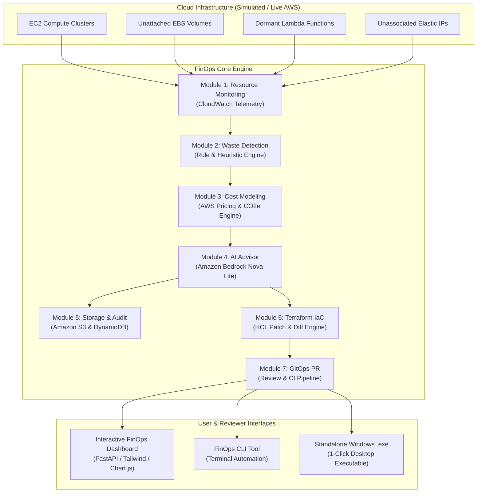

# FinOps Cloud Waste Hunter & Auto-Remediator

[](https://www.python.org/)
[](https://fastapi.tiangolo.com/)
[](https://aws.amazon.com/bedrock/)
[](https://www.terraform.io/)
[](https://github.com/)
[](LICENSE)

An automated Cloud Cost Optimization and DevOps platform that continuously monitors cloud infrastructure, discovers resource waste (unattached storage, idle serverless, and oversized compute), leverages **Amazon Bedrock Nova Lite** for actionable optimization insights, generates **Terraform IaC patches**, and enforces human review via **GitOps pull-request workflows**.

---

## 🎓 Academic Project Profile
- **Institution:** School of Computer Science Engineering and Information Systems, Vellore Institute of Technology (VIT)
- **Course Code:** ISWE309L Cloud Computing
- **Slot:** A1 + TA1
- **Review Phase:** Course Project Review-1
- **Project Team:**
  - **Vivek Pandey** &bull; Reg No: `24MIS0216` &bull; Email: `vivek.pandey2024@vitstudent.ac.in`
  - **S. Hemal** &bull; Reg No: `24MIS0050` &bull; Email: `hemal.s2024@vitstudent.ac.in`

---

## 🌟 Key Features & Problem Solved

Traditional cloud monitoring dashboards surface metrics but isolate detection from remediation, creating manual friction and persistent budget waste. **FinOps Cloud Waste Hunter** closes this loop:

$$\text{Resource Monitoring} \longrightarrow \text{Waste Detection} \longrightarrow \text{Cost Modeling} \longrightarrow \text{Bedrock AI Analysis} \longrightarrow \text{S3/DynamoDB Audit} \longrightarrow \text{Terraform Patching} \longrightarrow \text{GitOps Review}$$

1. **Module 1: Resource Monitoring**: Polls 30-day CloudWatch metrics (CPU, RAM, disk IOPS, network, attachments, invocation counts).
2. **Module 2: Multi-Vector Waste Detection**:
   - **Unattached Storage**: Orphaned EBS volumes (>7 days unattached) and unreferenced snapshots.
   - **Idle Serverless**: Inactive AWS Lambda functions with 0 invocations and dormant provisioned concurrency.
   - **Oversized Compute**: Underutilized EC2 instances (<10% avg CPU) mapped to right-sized families.
   - **Idle Networking**: Unassociated Elastic IPs incurring non-attachment fees and dormant NAT Gateways.
3. **Module 3: FinOps Cost & Carbon Modeling**: Real-time AWS SKU pricing engine calculating monthly spend, optimized spend, annualized ROI, and CO2e carbon reduction.
4. **Module 4: Amazon Bedrock Nova Lite AI Advisor**: Synthesizes human-readable rationales, risk levels (Low/Medium/High), step-by-step remediation procedures, and zero-downtime rollback strategies.
5. **Module 5: Report Storage & Audit Ledger**: Publishes full audit reports to **Amazon S3** (`s3://finops-waste-hunter-reports/`) and records indexed audit histories in **Amazon DynamoDB** (`FinOpsAuditTrail`).
6. **Module 6: Terraform Remediation**: Ingests infrastructure configurations and generates validated HCL patches (`main.tf`) with side-by-side unified diffs.
7. **Module 7: GitOps Review & Approval**: Branches into `gitops/remediation-run-*`, creates automated Pull Requests with CI/CD checks (`terraform validate`, `Cost Policy`, `Bedrock Guardrail`), and triggers controlled deployment upon reviewer sign-off.

---

## 🏗️ Architecture & Workflow



---

## 📋 Requirements Traceability Matrix

| Requirement | Description | Module Implementation | Verification Status |
| :--- | :--- | :--- | :---: |
| **FR1** | Collect and monitor resource-usage metrics | `core/module1_monitoring.py` | ✅ Verified |
| **FR2** | Identify unattached storage, idle serverless, oversized compute | `core/module2_waste_detection.py` | ✅ Verified |
| **FR3** | Classify detected waste by resource type | `core/models.py` (`ResourceType`) | ✅ Verified |
| **FR4** | Estimate potential monthly savings for detected waste | `core/module3_cost_estimation.py` | ✅ Verified |
| **FR5** | Provide detected waste to Amazon Bedrock Nova Lite | `core/module4_ai_advisor.py` | ✅ Verified |
| **FR6** | Generate optimization recommendations for identified waste | `core/module4_ai_advisor.py` | ✅ Verified |
| **FR7** | Generate reports containing waste, recs, and savings | `core/module5_storage.py` | ✅ Verified |
| **FR8** | Store reports and structured data in S3 and DynamoDB | `core/module5_storage.py` | ✅ Verified |
| **FR9** | Generate Terraform patches for recommended changes | `core/module6_terraform.py` | ✅ Verified |
| **FR10** | Submit generated changes as GitOps pull requests | `core/module7_gitops.py` | ✅ Verified |
| **FR11** | Keep infrastructure modifications reviewable before deployment | `core/module7_gitops.py` & Web UI | ✅ Verified |

---

## 🚀 Getting Started

### Prerequisites
- Python 3.10+ (Tested on Python 3.14 on Windows)
- Modern web browser (Chrome, Edge, Firefox)
- *Optional:* AWS credentials if connecting to live AWS account (`AWS_ACCESS_KEY_ID`, `AWS_SECRET_ACCESS_KEY`)

### 1. Instant 1-Click Launch (Windows)
Double-click:
```bat
start_app.bat
```
This automatically boots the backend server and opens `http://localhost:8080/` in your browser.

### 2. Manual Run via Python
```bash
# Clone the repository
git clone https://github.com/your-username/finops-cloud-waste-hunter.git
cd finops-cloud-waste-hunter

# Install dependencies
pip install -r requirements.txt

# Run web app & dashboard
python run_app.py
```

### 3. Command Line Interface (CLI)
For headless CI/CD execution or quick terminal demonstrations:
```bash
# Run full scan on Enterprise scenario
python cli.py --scenario enterprise

# Inspect a specific module (e.g., Module 4: Bedrock AI)
python cli.py --module 4

# Export audit report in Markdown format
python cli.py --format markdown > finops-audit-report.md
```

### 4. Compiling Standalone `.exe` Binary
To package the app into a standalone Windows executable:
```bat
build_exe.bat
```
The compiled executable will be generated at `dist/FinOps-Waste-Hunter/FinOps-Waste-Hunter.exe`.

---

## 📂 Project Directory Structure

```
finops-cloud-waste-hunter/
├── core/
│   ├── models.py                   # Pydantic data schemas across all 7 modules
│   ├── module1_monitoring.py       # Module 1: CloudWatch telemetry & inventory
│   ├── module2_waste_detection.py  # Module 2: Waste detection heuristic rules
│   ├── module3_cost_estimation.py  # Module 3: AWS pricing engine & CO2e calculation
│   ├── module4_ai_advisor.py       # Module 4: Amazon Bedrock Nova Lite advisor
│   ├── module5_storage.py          # Module 5: Amazon S3 & DynamoDB audit ledger
│   ├── module6_terraform.py        # Module 6: Terraform HCL patch & diff engine
│   ├── module7_gitops.py           # Module 7: GitOps pull request review engine
│   └── engine.py                   # End-to-end FinOps Orchestrator
├── app/
│   ├── server.py                   # FastAPI REST API backend
│   └── static/
│       ├── index.html              # Modern dark-mode FinOps dashboard
│       ├── styles.css              # Glassmorphism, badges, and diff syntax styles
│       └── app.js                  # Frontend controllers, Chart.js, and PR logic
├── sample_infrastructure/
│   ├── main.tf                     # Target Terraform infrastructure setup
│   └── variables.tf                # Deployment variables
├── data/
│   └── scenarios.py                # Enterprise, Startup, and Clean cloud datasets
├── storage/
│   ├── s3_bucket/reports/          # S3 audit files (JSON and Markdown)
│   └── dynamodb/                   # DynamoDB persistent audit table records
├── tests/
│   └── test_modules.py             # 100% passing unit tests for all 7 modules
├── cli.py                          # Terminal CLI runner
├── run_app.py                      # Desktop/Browser launcher
├── start_app.bat                   # 1-click Windows runner
├── finops.bat                      # Windows CLI shortcut
├── build_exe.bat                   # PyInstaller standalone executable builder
├── requirements.txt                # Python project dependencies
└── README.md                       # Comprehensive documentation
```

---

## 🧪 Automated Testing
Run the automated test suite covering all modules:
```bash
python -m unittest discover -s tests -p "test_*.py"
```

Output:
```text
Ran 8 tests in 0.065s
OK
```

---

## 📚 Academic References
1. A. Q. Khan, M. Matskin, R. Prodan, C. Bussler, D. Roman, et al., "Cost modelling and optimisation for cloud: a graph-based approach," *Journal of Cloud Computing*, vol. 13, 2024.
2. M. Smendowski and P. Nawrocki, "Optimizing multi-time series forecasting for enhanced cloud resource utilization based on machine learning," *Knowledge-Based Systems*, vol. 304, 2024.
3. M. Smendowski and P. Nawrocki, "FinOps-driven optimization of cloud resource usage for high-performance computing using machine learning," *Journal of Computational Science*, vol. 79, 2024, Article 102292.
4. A. Q. Khan, M. Matskin, R. Prodan, C. Bussler, D. Roman, et al., "Cloud storage cost: a taxonomy and survey," *The World Wide Web Journal*, vol. 27, 2024.
5. L. Cao, T. Huo, S. Li, et al., "Cost optimization in edge computing: a survey," *Artificial Intelligence Review*, vol. 57, 2024.

---

## 📄 License
This project is licensed under the MIT License - see the LICENSE file for details.
